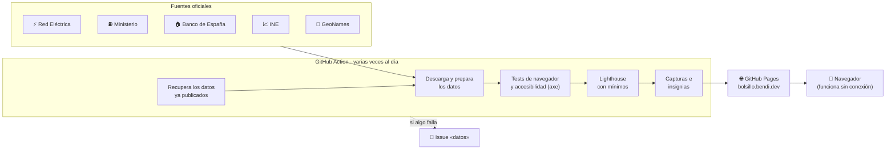

<div align="center">

<a href="https://bolsillo.bendi.dev/"></a>

# bolsillo

**Lo que cuesta el día a día, con datos oficiales.**<br>
Luz hora a hora, gasolineras más baratas, hipoteca e inflación. Sin cookies, sin anuncios, sin registro.

[](https://bolsillo.bendi.dev/)
[](https://bolsillo.bendi.dev/en/)

[](https://github.com/serbenda/bolsillo/actions/workflows/publicar.yml)
[](https://github.com/serbenda/bolsillo/actions/workflows/publicar.yml)
[](https://github.com/serbenda/bolsillo/actions/workflows/publicar.yml)
[](https://github.com/serbenda/bolsillo/actions/workflows/publicar.yml)
[](https://github.com/serbenda/bolsillo/actions/workflows/publicar.yml)
<br>


[](https://github.com/sponsors/serbenda)
[](LICENSE)

<a href="https://bolsillo.bendi.dev/"></a>

</div>

---

## Cuatro preguntas de casa

Cada sección responde a una pregunta con un titular claro, y debajo pone los datos para quien quiera mirarlos.

<table>
<tr>
<td width="50%" valign="top">

### ⚡ ¿Cuándo pongo la lavadora?
**[bolsillo.bendi.dev/luz](https://bolsillo.bendi.dev/luz/)**

- Precio PVPC **hora a hora**, hoy y mañana.
- **Con o sin impuestos**, con un interruptor.
- **Qué vas a poner** (lavadora, lavavajillas, secadora, horno o coche eléctrico) y cuándo sale más barato.
- **Cuánto cuesta en euros** cada aparato ahora y en el mejor momento.
- **Por qué está cara o barata**: de dónde sale la electricidad y cuánto más barata es los días con más renovables.
- **Avisos**: con la app instalada (Chrome o Edge), cada tarde te dice la hora más barata de mañana.

</td>
<td width="50%" valign="top">


</td>
</tr>
<tr>
<td width="50%" valign="top">


</td>
<td width="50%" valign="top">

### ⛽ ¿Dónde echo gasolina?
**[bolsillo.bendi.dev/gasolina](https://bolsillo.bendi.dev/gasolina/)**

- Las **más baratas cerca de ti**, por ubicación o **cualquier código postal**.
- **Solo las abiertas ahora**, según el horario de cada gasolinera.
- Gasolina 95 y 98, diésel, diésel premium y GLP, de 2 a 25 km.
- **¿Echo hoy o espero?**: el precio de hoy frente a la semana en tu provincia, con la media de España al lado.
- **Precio por provincia**: dónde está hoy más barato y más caro cada combustible.
- Mapa, distancia, horario, «Cómo llegar» y lo que ahorras en un depósito.

</td>
</tr>
<tr>
<td width="50%" valign="top">

### 🏠 ¿Cuánto me sube la hipoteca?
**[bolsillo.bendi.dev/hipoteca](https://bolsillo.bendi.dev/hipoteca/)**

- Tu **cuota nueva** con el último Euríbor frente al de tu última revisión.
- **Escenarios** si el Euríbor sube o baja medio punto o uno.
- **¿Y si amortizo?**: reducir cuota frente a reducir plazo, en euros de intereses.
- El **Euríbor desde 1999**, con tu revisión marcada.

</td>
<td width="50%" valign="top">


</td>
</tr>
<tr>
<td width="50%" valign="top">


</td>
<td width="50%" valign="top">

### 📈 ¿Cuánto ha subido la vida?
**[bolsillo.bendi.dev/ipc](https://bolsillo.bendi.dev/ipc/)**

- La **inflación del último año**, en una frase.
- **Calculadora**: cuánto valen hoy tus euros de cualquier mes desde 2002.
- La **inflación mes a mes**, con el periodo de tu cálculo sombreado.
- **¿Tu sueldo ha subido más que los precios?**: si has ganado o perdido poder de compra, en euros.

</td>
</tr>
<tr>
<td width="50%" valign="top">

### 🛒 ¿Cuánto ha subido la compra?
**[bolsillo.bendi.dev/compra](https://bolsillo.bendi.dev/compra/)**

- Cuánto **más cara está la compra** que hace un año, en una frase.
- **Lo que sube y lo que baja**: huevos, aceite, carne, fruta, café… con el IPC por producto.
- **Tu compra de entonces, hoy**: hace un mes, un año, 2, 5 o 10 años.
- **Año a año desde 2002**, de toda la comida o de cada producto, y cómo leer los datos.
- Enlaces a comparadores de **supermercados** independientes.

</td>
<td width="50%" valign="top">


</td>
</tr>
<tr>
<td width="50%" valign="top">

### 🔑 ¿Cuánto me pueden subir el alquiler?
**[bolsillo.bendi.dev/alquiler](https://bolsillo.bendi.dev/alquiler/)**

- El **límite oficial del INE (IRAV)** para las subidas de cada mes.
- **En euros**: con tu renta y el mes de la subida, cuánto te pueden subir como mucho.
- Contratos anteriores al 26 de mayo de 2023, con el IPC.

</td>
<td width="50%" valign="top">

### 🐷 ¿Cuánto rinden mis ahorros?
**[bolsillo.bendi.dev/ahorro](https://bolsillo.bendi.dev/ahorro/)**

- Lo que pagan las **Letras del Tesoro** a 3, 6, 9 y 12 meses en la última subasta.
- **Cuánto ganarías**, antes y después de Hacienda.
- Lo que **se come la inflación** si dejas el dinero parado.

</td>
</tr>
<tr>
<td width="50%" valign="top">

### 🔥 ¿Cuánto cuesta la calefacción?
**[bolsillo.bendi.dev/calefaccion](https://bolsillo.bendi.dev/calefaccion/)**

- El precio de la **bombona de butano** y su evolución.
- La **tarifa regulada del gas (TUR)**: cuánto pagarías al año según tu consumo.
- **¿Butano o gas?**: precio de cada kWh de calor.

</td>
<td width="50%" valign="top">

### 🧾 Y además
- **Tu bolsillo hoy** en la portada, con lo que has escrito en cada sección.
- **Gasolina por provincia**: una página para cada una, con las 10 más baratas.
- **Imagen para compartir** de cada sección con el dato del día.

</td>
</tr>
</table>

En cada sección, **Compartir** manda el resultado (tu cuota, tu compra, la hora más barata) con una imagen lista para WhatsApp; si el navegador no sabe compartir, copia el texto y el enlace.

<div align="center">

&nbsp;&nbsp;

<br>
<sub>Pensada para el móvil, con modo oscuro, y se puede instalar como app.</sub>
</div>

> Las capturas se hacen solas en cada publicación con los datos de ese día, así que siempre enseñan la web tal y como está.

---

## De dónde salen los datos

Todo es público y oficial. bolsillo no guarda nada en el repositorio: los datos se descargan en cada publicación.

| | Fuente | Qué se usa | Se actualiza |
|---|---|---|---|
| ⚡ | [Red Eléctrica (REData)](https://www.ree.es/es/datos/apidatos) | PVPC 2.0TD peninsular por horas; generación diaria por tecnología | Varias veces al día; el precio de mañana, hacia las 20:15 |
| ⛽ | [Ministerio para la Transición Ecológica](https://datos.gob.es/es/catalogo/e05068001-precio-de-carburantes-en-las-gasolineras-espanolas) | Precio de cada gasolinera de venta al público (~11.000) | Varias veces al día |
| 📮 | [GeoNames](https://www.geonames.org/) (CC BY 4.0) | Coordenadas de los códigos postales | En cada publicación |
| 🏠 | [Banco de España](https://www.bde.es/webbe/es/estadisticas/recursos/api-estadisticas-bde.html) | Euríbor a un año, serie `D_1NBAF472`, desde 1999 | Mensual |
| 🛒 | [INE](https://www.ine.es/dyngs/IPC/es/index.htm) | Rúbricas del IPC: alimentos (`IPC290811`) y una veintena de productos | Mensual |
| 🔑 | [INE](https://www.ine.es/dyngs/INEbase/es/operacion.htm?c=Estadistica_C&cid=1254736177110&idp=1254735976607) | Índice de Referencia de Arrendamientos de Vivienda, serie `IRAV1` | Mensual |
| 🐷 | [Banco de España](https://www.bde.es/webbe/es/estadisticas/recursos/api-estadisticas-bde.html) | Subastas de Letras del Tesoro (`D_DTED0C0G`, `D_DTED0E0G`, `D_DTED0I0G`, `D_DTED0G0G`) y bono a 10 años (`D_G0B1F0ZP`) | Mensual / diaria |
| 🔥 | [BOE](https://www.boe.es/) y [MITECO](https://www.miteco.gob.es/es/energia/hidrocarburos-nuevos-combustibles/glp/precios.html) | Precio máximo del butano envasado y tarifa de último recurso del gas natural (a mano, con aviso cuando caducan) | Bimestral / trimestral |
| 📈 | [INE](https://www.ine.es/dyngs/IPC/es/index.htm) | IPC general nacional, serie `IPC290751` (base 2025), desde 2002 | Mensual |
| 🗺️ | [OpenStreetMap](https://www.openstreetmap.org/copyright) | Mapa de gasolineras | Solo al buscar |

Además, bolsillo **construye su propio histórico** de precios medios de carburantes por provincia (cada día que pasa, uno más), que alimenta el «¿Echo hoy o espero?».

---

## Cómo funciona

Es una web **estática**: HTML, CSS y JavaScript sin frameworks ni dependencias en producción. Todo el trabajo lo hace una GitHub Action que descarga los datos, los prepara, prueba la web y la publica en GitHub Pages.



### Lo que hace la Action, paso a paso

1. **Tests unitarios** de toda la lógica: lectura de cada API, cuotas, tramos baratos, horarios, inflación…
2. **Recupera los datos publicados**: si una fuente falla, la web se queda con los últimos datos buenos en vez de quedarse vacía.
3. **Descarga los datos** de las cinco fuentes y los prepara para que el móvil descargue lo mínimo: las gasolineras y los códigos postales se reparten por provincia.
4. **Descarga la fuente y el mapa** (Archivo y Leaflet) para servirlos desde la propia web, sin Google Fonts ni CDN.
5. **Genera los iconos** de la app y la imagen para compartir a partir del logo SVG.
6. **Tests de navegador** con Playwright y datos reales en todas las páginas, y **auditoría de accesibilidad** con axe (WCAG 2 AA).
7. **Lighthouse** en móvil para cada página, con mínimos de rendimiento, accesibilidad, buenas prácticas y SEO. Si no llega, **no se publica**.
8. **Capturas e insignias** para este README.
9. **Publica** en GitHub Pages. En las PR hace todo lo anterior menos publicar, así que el check de la PR ya dice si todo va bien.
10. Si algo falla (una fuente, los tests o la publicación), **abre un issue** con la etiqueta `datos` y el enlace a la ejecución. Cuando vuelve a funcionar, lo cierra solo.

Se ejecuta al fusionar en `main`, en cada PR, a mano y seis veces al día. Las Actions están fijadas por commit.

---

## En castellano y en inglés

Toda la web está en castellano y en inglés (**[bolsillo.bendi.dev/en](https://bolsillo.bendi.dev/en/)**), con un selector **ES / EN** en la cabecera que lleva a la misma página en el otro idioma con un clic.

- La versión en inglés se genera al publicar: `scripts/ingles.mjs` traduce el texto fijo de cada página con `scripts/traducciones.mjs` y **falla si queda algo sin traducir**, así que nunca se publica una página a medias.
- Lo que escriben los scripts (titulares, cálculos, avisos) sale en el idioma de la página, con sus números y fechas en formato inglés (`€0.21`, `2.7%`, `31 October`).
- Cada página enlaza a su versión en el otro idioma (`hreflang`), y el sitemap incluye las dos.
- Los tests de navegador comprueban que en las páginas en inglés no queda texto en castellano.

*Everything is also available in English at [bolsillo.bendi.dev/en](https://bolsillo.bendi.dev/en/), aimed at English speakers living in Spain.*

---

## Privacidad

- **Sin cookies, sin anuncios y sin cuentas.**
- Las visitas se cuentan con [GoatCounter](https://www.goatcounter.com/), que no guarda datos personales.
- Tu ubicación, tu código postal, los datos de tu hipoteca y tus cálculos **no salen de tu navegador**.
- El mapa pide imágenes a OpenStreetMap solo cuando buscas gasolineras.

---

## Estructura

```
bolsillo/
├── index.html                Portada con el recibo del día
├── luz/  gasolina/  compra/  alquiler/  hipoteca/  ahorro/  ipc/  fuentes/
│                             (la versión en inglés, en/, se genera al publicar)
├── assets/
│   ├── css/estilos.css       Un solo fichero de estilos, con modo oscuro
│   ├── img/                  Logo y favicon en SVG (los PNG se generan)
│   └── js/
│       ├── ree.js            API de Red Eléctrica (navegador y Node)
│       ├── generacion.js     Generación por tecnología y efecto de las renovables
│       ├── ventana.js        Tramo más barato de N horas seguidas
│       ├── impuestos.js      IVA, impuesto eléctrico y consumo de cada aparato
│       ├── carburantes.js    Ministerio, provincias, horarios, códigos postales, histórico
│       ├── euribor.js        Euríbor, cuotas y amortización anticipada
│       ├── ipc.js            IPC, equivalencias e inflación interanual
│       ├── compra.js         Productos de la compra y su variación de precio
│       ├── idioma.js         Idioma de la página y formatos de números y fechas
│       └── …                 Un script por página y comun.js (sin conexión y visitas)
├── scripts/                  Lo que ejecuta la Action: datos, fuente, imágenes, Lighthouse, capturas
├── tests/                    Tests unitarios (node:test) y de navegador (tests/e2e)
├── sw.js                     Service worker: modo sin conexión
└── manifest.webmanifest      App instalable
```

Los módulos de `assets/js/` son los mismos en el navegador y en Node, así que la lógica que prueban los tests es exactamente la que corre en la web.

---

## En local

Necesitas Node 20 o superior. No hay dependencias que instalar para la web ni para los tests unitarios.

```bash
npm test          # tests unitarios
npm run datos     # descarga los datos de las fuentes a data/
npm run dev       # sirve la web en local
```

Para tenerlo todo, como en la Action (fuente, mapa, imágenes, tests de navegador, Lighthouse y capturas):

```bash
npm run herramientas && npx playwright install chromium
node scripts/vendor.mjs && node scripts/imagenes.mjs
# copia la web a _site/ como hace la Action y luego:
npm run e2e && npm run lighthouse && npm run capturas
```

---

## Mantenimiento

| Si cambia… | Dónde se toca |
|---|---|
| El IVA o el impuesto eléctrico de la luz | `assets/js/impuestos.js` (con la fecha desde la que aplica) |
| El consumo típico de un aparato | `APARATOS` en `assets/js/impuestos.js` |
| La serie del Euríbor o del IPC | `SERIE_EURIBOR` en `euribor.js` o `SERIE_IPC` en `ipc.js` |
| Los mínimos de Lighthouse | `CATEGORIAS` en `scripts/lighthouse.mjs` |
| Un texto fijo de una página | El HTML en castellano y su traducción en `scripts/traducciones.mjs` (si falta, la publicación avisa) |
| Una fuente deja de responder | Llega un issue `datos` con el detalle; la web sigue con los últimos datos buenos |

---

## Preguntas frecuentes

<details>
<summary><b>¿El precio de la luz es el de mi factura?</b></summary>

Es el PVPC (tarifa regulada 2.0TD) de la península. Si tienes tarifa de mercado libre, tu precio es otro. Con impuestos se suman el impuesto eléctrico y el IVA del término de energía; la factura añade además la potencia contratada y el alquiler del contador.
</details>

<details>
<summary><b>¿Y Canarias, Baleares, Ceuta y Melilla?</b></summary>

La API abierta de Red Eléctrica solo publica el precio de la península. Para el resto hace falta un token de ESIOS; cuando lo haya, se añadirá un selector.
</details>

<details>
<summary><b>¿Cómo sabe si una gasolinera está abierta?</b></summary>

Por el horario que cada gasolinera declara al Ministerio («L-V: 07:00-22:00; S-D: 08:00-14:00», «L-D: 24H»…). Si un horario no se entiende, la gasolinera se muestra igualmente, sin marcarla como abierta ni cerrada.
</details>

<details>
<summary><b>¿El simulador de hipoteca es exacto?</b></summary>

Usa el sistema francés de amortización, que es el habitual. Es orientativo: tu banco aplica el índice y las condiciones de tu escritura (normalmente el Euríbor publicado uno o dos meses antes de la revisión) y puede cobrar comisión por amortizar.
</details>

<details>
<summary><b>¿Por qué el IPC empieza en 2002?</b></summary>

Es desde donde la API del INE ofrece la serie vigente (base 2025), que es la referencia oficial.
</details>

---

## Apoya el proyecto

bolsillo es gratis, sin anuncios y seguirá siéndolo. Si te ahorra dinero y quieres ayudar a mantenerlo, puedes apoyarlo en **[GitHub Sponsors](https://github.com/sponsors/serbenda)** ❤️

---

## Licencia

**© 2026 Bendi. Todos los derechos reservados.** El repositorio es público para que se pueda ver el código, pero no se concede licencia de uso: no se puede copiar, clonar para usarlo, modificar ni redistribuir sin permiso. Detalles en [LICENSE](LICENSE).

Los datos pertenecen a sus fuentes y se reutilizan según sus condiciones ([ver fuentes](https://bolsillo.bendi.dev/fuentes/)). bolsillo no está vinculado a ninguno de esos organismos.

<div align="center">
<br>
<a href="https://bendi.dev"></a>
</div>
